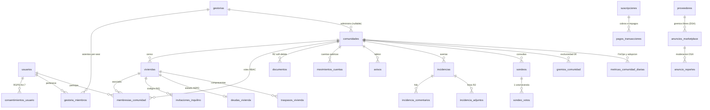

# Vecinda · Esquema de Base de Datos v2 (PostgreSQL 16)

> Fuente de verdad en SQL: [0001_initial_schema.sql](migrations/0001_initial_schema.sql) (**32 tablas** en 7 bloques).
> Diseñado para compilación estricta con **Rust (`SQLx`)**, aislamiento multi-tenant físico por `comunidad_id`, caché en RAM (`moka`), control de impagos/métricas FinOps y cumplimiento normativo (RGPD/AEPD, LPH y DSA).
> *(Esta v2 sirve como base sólida de arranque y podrá evolucionar mediante migraciones incrementales `0002_...` según avancen las fases).*

---

## 1. Diagrama Entidad-Relación (ER)

---

## 2. Aislamiento estricto entre comunidades (3 capas)

Cada comunidad mantiene sus datos completamente aislados del resto mediante tres barreras combinadas:
1. **Capa física en PostgreSQL (FKs compuestas):** `viviendas`, `documentos`, `incidencias` y `sondeos` exponen `UNIQUE (id, comunidad_id)`. Todas sus tablas hijas (`membresias_comunidad`, `deudas_vivienda`, `movimientos_cuentas`, `incidencia_comentarios`, `incidencia_adjuntos`, `sondeo_votos`, `traspasos_vivienda`) enlazan con clave foránea compuesta `(entidad_id, comunidad_id)`, haciendo imposible cruzar registros entre dos comunidades distintas.
2. **Capa lógica preparada para RLS (*Row-Level Security*):** todas las tablas operativas portan `comunidad_id` indexado, permitiendo activar políticas RLS con `SET LOCAL app.current_comunidad_id` por petición en fases de endurecimiento.
3. **Capa de aplicación y almacenamiento:** middleware RBAC en Rust, claves `moka` prefijadas por `:{comunidad_id}` y prefijos aislados en Cloudflare R2 (`comunidades/{comunidad_id}/{uuid}.pdf`).

---

## 3. Reglas de negocio, legales y correcciones aplicadas en v2

- **Sin doble membresía `PRESIDENTE` + `PROPIETARIO`:** `uq_membresias_activas_usuario_vivienda` impide que un mismo usuario tenga dos filas activas sobre la misma vivienda; al pasar a `PRESIDENTE` conserva su vínculo con `vivienda_id` (LPH art. 13.2).
- **Copropietarios con voto único y coeficiente congelado:** múltiples copropietarios pueden acceder al mismo piso, pero `sondeo_votos` limita a `1` voto por `(sondeo_id, vivienda_id, es_inquilino)` y guarda `coeficiente_snapshot`.
- **Borrado lógico anti-huérfanos y derecho de supresión (RGPD Art. 17):** `usuarios`, `gestorias`, `comunidades` y `documentos` usan `eliminado_en`. Permite anonimizar ex-vecinos sin romper `ON DELETE RESTRICT` contable y purgar ficheros en Cloudflare R2 antes de borrar su fila.
- **Aislamiento de morosidad (AEPD) y LPH 3 años:** `deudas_vivienda` vive separada de `movimientos_cuentas` y `avisos`, con `desglose_anual_json` (año en curso + 3 años anteriores, LPH art. 9.1.e).
- **Impagos, antigüedad y retención (`suscripciones`):** ciclo `TRIAL → ACTIVA → IMPAGO_GRACIA → IMPAGO_SUSPENDIDA` (paso a solo lectura sin pérdida ni secuestro de datos legales), conservando `inicio_suscripcion_en` (antigüedad real en meses), `motivo_cancelacion` y pagos idempotentes (`webhook_eventos_procesados`).
- **Marketplace geográfico y DSA:** `codigo_postal` y `provincia` en comunidades y proveedores; `kybc_verificado_en` (Art. 30 DSA); `anuncio_reportes` para notificación y retirada.
- **Referidos B2B (máx. 3 por usuario) y antifraude CIF:** `invitaciones_referido` limita en backend a 3 invitaciones con `30 días` de prueba gratis; `cif_estado_verificacion` en `gestorias` y `proveedores` junto a `cif` único y `suscripciones.payment_fingerprint` impiden duplicar meses gratis con CIFs falsos o repetidos.

---

## 4. Estrategia de métricas en 3 capas (sin cookies invasivas ni sobrecarga SQL)

1. **Métricas de negocio y FinOps en PostgreSQL (`0 €`):**
   - `suscripciones` y `pagos_transacciones`: MRR/ARR por vía de ingreso, antigüedad, tasa de impago, *churn* y LTV.
   - `metricas_comunidad_diarias`: el backend Rust acumula lecturas y *cache hits/misses* en contadores atómicos en RAM y ejecuta un único `UPSERT` en lote cada **5–10 minutos** (cero impacto en cada petición vecinal).
   - `eventos_producto` (sin PII, retención 90 días): embudos clave (`onboarding_completado`, `invitacion_canjeada`, `traspaso_solicitado`).
   - `metricas_anuncio_diarias`: impresiones y clics agregados por comunidad sin rastrear individuos.
2. **Analítica UX *Privacy-First* en Frontend (`0 €`):** **Cloudflare Web Analytics** (sin cookies, compatible con RGPD sin banner invasivo, *Core Web Vitals* y dispositivos reales).
3. **Errores y rendimiento técnico:** **Sentry** (plan Developer en región UE + *data scrubbing*) y métricas p95 con `tracing` en Rust.

---

## 5. Mapa de invalidación de caché `moka` por `comunidad_id`

| Escritura en tabla | Clave(s) `moka` a invalidar |
|---|---|
| `movimientos_cuentas` | `cuentas_resumen:{comunidad_id}`, `cuentas_lista:{comunidad_id}:*` |
| `avisos` | `avisos:{comunidad_id}:*`, `inicio_resumen:{comunidad_id}` |
| `incidencias` / `incidencia_comentarios` / `incidencia_adjuntos` | `incidencias:{comunidad_id}:*`, `inicio_resumen:{comunidad_id}` |
| `sondeos` / `sondeo_votos` | `sondeos:{comunidad_id}:*`, `inicio_resumen:{comunidad_id}` |
| `gremios_comunidad` / `anuncio_comunidades` / `anuncio_reportes` | `marketplace_comunidad:{comunidad_id}` |
| `membresias_comunidad` / `viviendas` | `rbac_usuario:{usuario_id}:{comunidad_id}`, `censo:{comunidad_id}` |
| `suscripciones` | `plan_estado:{gestoria_id|comunidad_id}` |
| `deudas_vivienda` / `traspasos_vivienda` | *(No se cachean en claves públicas; consulta directa o caché privada estricta por rol)* |
